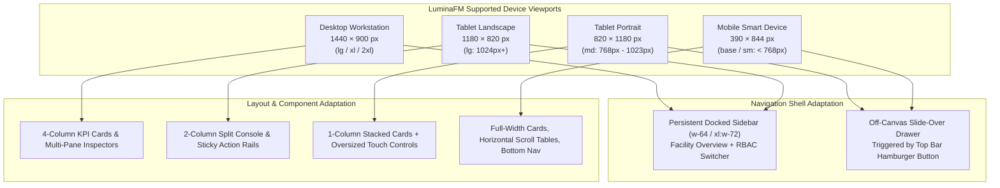

# LuminaFM Responsive & Device-Specific User Guides

This directory contains comprehensive operational guides and architectural specifications for using LuminaFM across all supported device form factors and viewport dimensions: **Desktop Workstations**, **Tablet Landscape (Field Engineering & Inspection)**, **Tablet Portrait (Industrial Floor Operator Kiosk)**, and **Mobile Smart Devices (On-Call Technicians & Field Supervision)**.

---

## 1. Responsive Architecture & Viewport Standards

LuminaFM is engineered with a mobile-responsive, touch-accessible, and dark-mode-first architecture tailored for industrial boiler plant rooms, engineering control centers, and corporate facilities.

The interface adapts dynamically across viewport breakpoints using Tailwind CSS utility classes and hardware-accelerated CSS flexbox/grid containers.

---

## 2. Tested Hardware & Emulation Matrix

All LuminaFM screens, overlays, and workflows were verified against four reference viewport configurations:

| Device Category | Target Form Factor | Viewport Resolution | Pixel Density / Ratio | CSS Breakpoint Tier | Primary User Profiles | Primary Use Case |
|---|---|---|---|---|---|---|
| **Desktop Workstation** | Enterprise PC / Mac Monitor | **$1440 \times 900\text{ px}$** | $1.0\times$ / $2.0\times$ (Retina) | `lg:` / `xl:` ($1280\text{px}+$) | Organization Admin, Plant Reliability Engineer | Command Center, Cost Analytics, ANP Model Governance, Evidence Vault |
| **Tablet Landscape** | Apple iPad Air/Pro, Samsung Galaxy Tab | **$1180 \times 820\text{ px}$** | $2.0\times$ | `lg:` ($1024\text{px} - 1279\text{px}$) | Plant Reliability Engineer, Maintenance Technician | Field PM Execution, Inspection Walkthroughs, Dual-Pane Kiosk |
| **Tablet Portrait** | Industrial Rugged Tablet (Zebra, Getac, iPad in Rugged Case) | **$820 \times 1180\text{ px}$** | $2.0\times$ | `md:` ($768\text{px} - 1023\text{px}$) | Boiler Plant Operator, Maintenance Technician | Boiler Floor Kiosk (`/operator`), Glove Numpad Telemetry, QR Scanning |
| **Mobile Smart Device** | iPhone 14/15/16, Samsung Galaxy S Series | **$390 \times 844\text{ px}$** | $3.0\times$ | `base` ($< 640\text{px}$) | On-Call Technician, Plant Reliability Engineer | Shift Alerts, Work Order Status Verification, Quick Telemetry Check |

---

## 3. Touch Target & Industrial Ergonomics Standards

In compliance with **WCAG 2.1 AAA** guidelines and industrial human-machine interface (HMI) standards for manufacturing environments:

1. **Standard Interactive Targets ($\ge 44 \times 44\text{ px}$)**:
   - All standard buttons, hamburger triggers, table action icons, dropdown selectors, and navigation links maintain a minimum bounding box of $44 \times 44\text{ px}$ (`min-h-[44px] min-w-[44px]`).
2. **Glove-Friendly Touch Targets ($\ge 56 \times 56\text{ px}$ to $64 \times 64\text{ px}$)**:
   - In the Purpose-Built Factory-Floor Operator Kiosk (`/operator`), numerical keypad keys (`GloveNumpad.tsx`) maintain a minimum touch target of $56\text{ px}$ on compact screens and $64\text{ px}$ (`min-h-[64px]`) on standard tablets, with $8\text{ px}$ margins (`gap-2 sm:gap-3`) to prevent accidental adjacent key presses when wearing heavy leather or thermal safety gloves.
3. **Tactile Industrial Glove Rockers ($\ge 52\text{ px}$ height)**:
   - Pass/Conditional/Fail inspection rockers (`GloveRockerSwitch.tsx`) feature large $52\text{ px}$ height physical-style touch segments with high-contrast color coding (Emerald `#059669`, Amber `#d97706`, Rose `#e11d48`).
4. **Dark Mode Thermal Contrast**:
   - Palette utilizes deep midnight slate (`#020617` and `#0f172a`) paired with gold amber (`#f59e0b`), cyan indigo (`#6366f1`), and emerald (`#10b981`) accents to maximize readability under harsh boiler room low-pressure sodium lamps, fluorescent glare, and direct sunlight.

---

## 4. Directory Structure of Device Guides

| Guide | Target Device & Viewport | Core Architectural Coverage |
|---|---|---|
| [01. Desktop Workstation Guide](file:///e:/My%20Owns/docs/user-manual/08-device-guides/01-desktop-guide.md) | **Desktop ($1440 \times 900$)** | Persistent sidebar (`w-64` / `xl:w-72`), 4-column metric grids, multi-pane asset inspectors, large ANP Supermatrix tables, hover states, keyboard shortcuts (`ESC`, `Tab`, `Enter`). |
| [02. Tablet Landscape Guide](file:///e:/My%20Owns/docs/user-manual/08-device-guides/02-tablet-landscape-guide.md) | **Tablet Landscape ($1180 \times 820$)** | 2-column split layouts, persistent sidebar adaptation (`lg:flex`), touch-friendly table rows, dual-pane Floor Kiosk mode, touch-drag Kanban interactions. |
| [03. Tablet Portrait Guide](file:///e:/My%20Owns/docs/user-manual/08-device-guides/03-tablet-portrait-guide.md) | **Tablet Portrait ($820 \times 1180$)** | Collapsible off-canvas drawer (`lg:hidden`), single-column stacked telemetry cards, oversized tactile controls, Glove Numpad overlay, QR Asset Scanner camera modal, Sync Queue drawer. |
| [04. Mobile Phone Guide](file:///e:/My%20Owns/docs/user-manual/08-device-guides/04-mobile-phone-guide.md) | **Mobile ($390 \times 844$)** | Compact single-column viewport, top bar hamburger menu, stacked KPI summary cards, horizontally scrolling data tables with sticky column headers, touch-optimized forms. |
| [05. Industrial Kiosk Ergonomics & Offline Engine](file:///e:/My%20Owns/docs/user-manual/08-device-guides/05-industrial-kiosk-ergonomics.md) | **Rugged Plant-Floor Tablets** | Glove Mode calibration, $64\text{px}$ keypad geometry, high-contrast thermal readability, camera QR barcode decoding in dim basements, IndexedDB offline sync queue, ServiceWorker background retry. |
| [06. Responsive Compatibility Report](file:///e:/My%20Owns/docs/user-manual/08-device-guides/06-responsive-compatibility-report.md) | **Cross-Device Audit** | Comprehensive page-by-page and overlay audit across all 14 routes and 21 modals, verified behavioral differences, limitations, and operational recommendations. |
