# LuminaFM Continuous Documentation Maintenance Standard Operating Procedure (SOP)

**Document ID:** LFM-SOP-DOC-001  
**Version:** 1.0.0  
**Effective Date:** November 15, 2026  
**Audience:** Technical Writers, Reliability Engineers, Frontend Developers, QA Engineers, Release Managers  
**Governing Rule:** *Never silently leave outdated screenshots, obsolete routes, or inaccurate instructions in the published manual. The documentation must evolve in lockstep with the LuminaFM platform.*

---

## 1. Purpose & Continuous Documentation Policy

This document establishes the mandatory, repeatable engineering process for keeping the **LuminaFM Complete Visual User Guide and User Manual** continuously synchronized with all future application releases, schema migrations, and UI revisions.

Documentation in LuminaFM is treated as **production code**. Any pull request (PR) that alters user-facing screens, navigation paths, form fields, state machine logic, RBAC permissions, or decision models must include corresponding updates to the manual, inventories, and publication deliverables before merging into the main release branch.

```mermaid
flowchart TD
    subgraph Trigger["1. Release & Code Change Triggers"]
        T1["Route / Page Added or Modified"]
        T2["Component / Form / Field Updated"]
        T3["Modal / Drawer Added or Changed"]
        T4["RBAC Role or Permission Updated"]
        T5["Decision Model / Workflow Changed"]
    end

    subgraph ImpactAnalysis["2. Change Impact Analysis"]
        IA1["Execute Change Impact Assessment"]
        IA2["Identify Affected Manual Sections"]
        IA3["Flag Stale Screenshots & Callouts"]
    end

    subgraph CaptureAndAnnotate["3. Screenshot & Content Lifecycle"]
        SC1["Capture Fresh Viewport Screenshots (1440, 1180, 820, 390)"]
        SC2["Generate Gold Circular Annotated Callout Images"]
        SC3["Update Page, Modal, and Workflow Documentation"]
        SC4["Update Markdown Inventories & Screenshot Index"]
    end

    subgraph BuildAndAudit["4. Automated Compilation & Verification"]
        B1["Run build_html_manual.py (Interactive Portal)"]
        B2["Run build_pdf_manual.py (245-Page Master PDF)"]
        B3["Run build_quick_start_guide.py & build_admin_guide.py"]
        B4["Run audit_verification.py (Integrity Gate)"]
    end

    subgraph ReleaseSignoff["5. Publication & Release"]
        REL["Update CHANGELOG.md & Publish Release Deliverables"]
    end

    Trigger --> ImpactAnalysis
    ImpactAnalysis --> CaptureAndAnnotate
    CaptureAndAnnotate --> BuildAndAudit
    BuildAndAudit --> ReleaseSignoff
```



---

## 2. Documentation Change Triggers

A formal documentation review is mandatory whenever a code change touches any of the following seven areas:

| Trigger Area | Codebase Indicators | Required Documentation Action |
|---|---|---|
| **1. UI Route Changes** | Changes in `frontend/src/App.tsx`, route additions, route renames, or path deprecations. | • Update `docs/user-manual/inventory/routes-inventory.md`<br/>• Update `docs/user-manual/07-reference/quick-navigation-reference.md`<br/>• Update table of contents in `build_html_manual.py` and `build_pdf_manual.py`. |
| **2. Page Layout Changes** | Modifications to pages in `frontend/src/pages/*.tsx`. | • Recapture viewport screenshots.<br/>• Update corresponding guide in `docs/user-manual/03-module-guides/`.<br/>• Update `docs/user-manual/inventory/pages-inventory.md`. |
| **3. Modal & Drawer Overlays** | Additions or modifications to modals in `frontend/src/components/**/*.tsx`. | • Recapture modal screenshot with background backdrop.<br/>• Update `docs/user-manual/03-module-guides/modal-reference/`.<br/>• Update `docs/user-manual/inventory/modals-inventory.md`. |
| **4. Form & Telemetry Fields** | Changes to input fields, Zod validation schemas, nominal ranges, or units. | • Update `docs/user-manual/07-reference/field-reference.md`.<br/>• Update field tables in relevant module guides.<br/>• Recapture screenshot if input labels or layout shifted. |
| **5. RBAC Roles & Permissions** | Changes to `AuthContext.tsx`, `UserRole` enums, or API middleware route guards. | • Update `docs/user-manual/07-reference/permissions-matrix.md`.<br/>• Update relevant guides in `docs/user-manual/04-role-based-guides/`.<br/>• Verify whether role badges or dropdowns changed. |
| **6. Operational Workflows** | Changes to state machines (e.g. Work Order statuses), task completion rules, or closeout requirements. | • Update corresponding workflow in `docs/user-manual/05-workflows/`.<br/>• Update `00-full-lifecycle-maintenance.md`.<br/>• Recapture workflow step screenshots. |
| **7. Decision Model Governance** | Changes to ANP criteria, weight matrices, consistency ratio ($CR$) thresholds, or equipment modules. | • Update `docs/user-manual/03-module-guides/11-decision-governance.md`.<br/>• Update `docs/user-manual/05-workflows/14-model-governance-baseline.md`.<br/>• Recapture supermatrix screenshots. |

---

## 3. Change Impact Analysis Protocol

Before making any documentation edits, the author must prepare a **Change Impact Assessment** using the following protocol:

1. **Step 1: Code Diff Inspection**:
   Run `git diff --stat origin/main` to identify modified frontend files, types, and backend route definitions.
2. **Step 2: Section Impact Mapping**:
   Map each modified file to its documentation chapter in `03-module-guides/`, `04-role-based-guides/`, `05-workflows/`, and `08-device-guides/`.
3. **Step 3: Stale Screenshot Identification**:
   Identify which existing screenshots in `docs/user-manual/screenshots/` display outdated visual UI states (e.g. altered button text, shifted columns, changed color tones, or new tabs).
4. **Step 4: Change Impact Report Drafting**:
   Document the planned changes using the Change Impact Report template (see Section 8).

---

## 4. Screenshot Capture & Annotation Lifecycle

To ensure consistent visual quality across releases, all screenshots must adhere to the standardized capture and annotation pipeline:

### 4.1 Target Viewport Specifications
All screenshots must be captured from the live, running application using browser device emulation or Playwright automation across four fixed viewports:

| Viewport Tier | Resolution (Width × Height) | Pixel Density | Purpose |
|---|---|---|---|
| **Desktop Workstation** | **$1440 \times 900\text{ px}$** | $1.0\times$ / $2.0\times$ | Standard enterprise dashboard, multi-column tables, DAG visualizers, 14×14 ANP matrices. |
| **Tablet Landscape** | **$1180 \times 820\text{ px}$** | $2.0\times$ | Inspection walk-throughs, 2-column Floor Kiosk mode, touch tables. |
| **Tablet Portrait** | **$820 \times 1180\text{ px}$** | $2.0\times$ | Handheld plant-floor tablet, Glove Numpad, QR scanner modal, sync drawer. |
| **Mobile Smart Device** | **$390 \times 844\text{ px}$** | $3.0\times$ | Smartphone on-call alarms, single-column KPI cards, bottom-sheet dialogs. |

### 4.2 Screenshot File Naming Convention
- Original clean screenshot: `docs/user-manual/screenshots/original/{MODULE}-{ID}-{kebab-case-slug}.png`
- Matching annotated screenshot: `docs/user-manual/screenshots/annotated/{MODULE}-{ID}-{kebab-case-slug}-annotated.png`

*Module Prefix Standards:*
- `DASH-` — Command Center Dashboard
- `AUTH-` — Authentication & Role Simulation
- `ASSET-` — Asset Master & Detail Drawer
- `HIER-` — Physical & Process DAG Hierarchies
- `CAL-` — Maintenance Calendar & PM Schedules
- `WO-` — Work Orders List, Kanban & Modals
- `INSP-` — Inspections & Fault History
- `LOG-` — Daily Shift Boiler Logbook
- `KIOSK-` — Factory-Floor Tablet Kiosk & Overlays
- `REP-` — Decision Support, Abnormalities & Alerts
- `AUDIT-` — Audit Trail, Evidence Vault & Compliance
- `COST-` — Maintenance Financial Cost Analysis
- `GOV-` — ANP Decision Governance & Baseline
- `SET-` — White-Label Branding & Deployment Settings
- `NAV-` — Navigation Shell & Role Popovers

### 4.3 Annotation Design Standards
Annotated screenshots must overlay numbered gold callout circles:
- **Badge Shape**: Perfect circle, minimum diameter $24\text{px}$ to $28\text{px}$.
- **Badge Fill**: Gold Amber (`#f59e0b`) with a semi-opaque drop shadow (`rgba(0,0,0,0.5)`).
- **Badge Border**: $1.5\text{px}$ solid Pure White (`#ffffff`).
- **Badge Typography**: Centered bold numerical digits (`1`, `2`, `3`, `4`, `5`, `6`) in pure white (`#ffffff`).
- **Placement**: Directly over or immediately adjacent to the targeted UI control without obscuring critical data text.
- **Documentation Pairing**: The numbered marker must match the corresponding callout table in the markdown guide.

---

## 5. Inventory Synchronization Workflow

Whenever a component, modal, route, or workflow is added or removed, the corresponding inventory file in `docs/user-manual/inventory/` must be immediately updated:

1. **`routes-inventory.md`**: Update route path, page component, primary user role, and access permission.
2. **`pages-inventory.md`**: Update page layout, primary widgets, action buttons, and responsive breakpoints.
3. **`components-inventory.md`**: Update UI component catalog, prop specifications, and file path.
4. **`modals-inventory.md`**: Update overlay trigger, form fields, validation constraints, and dismiss behavior.
5. **`workflows-inventory.md`**: Update workflow title, operational goal, required role, and step sequence.
6. **`screenshot-index.md`**: Record the new screenshot ID, file name, caption, viewport resolution, and date captured.

---

## 6. Continuous Publication Build Pipeline

LuminaFM includes an automated Python compilation toolchain located in [`docs/user-manual/builder/`](file:///e:/My%20Owns/docs/user-manual/builder/).

After updating source markdown files and screenshots, run the following automated build sequence:

```powershell
# 1. Compile the interactive HTML Documentation Portal (with search & lightbox)
python docs/user-manual/builder/build_html_manual.py

# 2. Compile the Master Enterprise User Manual PDF (245 pages)
python docs/user-manual/builder/build_pdf_manual.py

# 3. Compile the Plant Floor Field Quick Start Guide PDF (40 pages)
python docs/user-manual/builder/build_quick_start_guide.py

# 4. Compile the Executive Governance & Administrator Guide PDF (63 pages)
python docs/user-manual/builder/build_admin_guide.py

# 5. Execute the automated quality audit verification script
python docs/user-manual/builder/audit_verification.py
```

### Automated Quality Gate Verification
The `audit_verification.py` script automatically verifies:
- All 15 routes in `frontend/src/App.tsx` match the manual.
- All screenshots in `screenshots/original/` have an exact 1-to-1 match in `screenshots/annotated/`.
- All PDF files are valid, have correct page counts, and render without corrupt objects.
- All HTML links, search controls, and lightbox attributes are functional.
- RBAC roles in `AuthContext.tsx` match the manual.

If any check fails, the build pipeline exits with a non-zero exit code, blocking release.

---

## 7. Versioning & Changelog Protocol

LuminaFM documentation adheres to **Semantic Documentation Versioning (DocVer)**:
- **Major Version (`X.0.0`)**: Major platform overhaul, redesign of core navigation shell, or breaking changes to all operational workflows.
- **Minor Version (`1.X.0`)**: New module added (e.g. Chiller Extensibility Module), new route introduced, new modal added, or significant workflow enhancements.
- **Patch Version (`1.4.X`)**: Bug fixes in documentation text, typo corrections, field benchmark threshold updates, or screenshot recaptures for cosmetic UI tweaks.

All updates must be logged in [`docs/user-manual/CHANGELOG.md`](file:///e:/My%20Owns/docs/user-manual/CHANGELOG.md) following the "Keep a Changelog" standard (Added, Changed, Deprecated, Removed, Fixed, Security).

---

## 8. Change Impact Report Template

For every future release, the documentation engineer must attach a completed **Change Impact Report** to the release ticket:

```markdown
# LuminaFM Documentation Change Impact Report: Release v[X.Y.Z]

**Release Date:** YYYY-MM-DD  
**Release Author:** [Name / Team]  
**Documentation Version:** v[X.Y.Z]  

### 1. Application Changes Summary
- **Changed Routes:** [List of changed routes or "None"]
- **New Pages Added:** [List of new pages or "None"]
- **Pages Removed / Deprecated:** [List of deprecated pages or "None"]
- **Changed Components:** [List of modified UI components]
- **New Modals / Drawers:** [List of new overlays or "None"]
- **Changed Forms / Fields:** [List of modified fields, validation rules, or units]
- **Changed RBAC Permissions:** [List of permission changes]
- **Changed Workflows:** [List of modified operational workflows]

### 2. Documentation Updates Executed
- [ ] Updated Module Guides in `docs/user-manual/03-module-guides/`
- [ ] Updated Modal Reference in `docs/user-manual/03-module-guides/modal-reference/`
- [ ] Updated Workflows in `docs/user-manual/05-workflows/`
- [ ] Updated Role-Based Guides in `docs/user-manual/04-role-based-guides/`
- [ ] Updated Reference Catalogs in `docs/user-manual/07-reference/`
- [ ] Updated Inventories in `docs/user-manual/inventory/`

### 3. Screenshot Recapture Log
| Screenshot ID | Description | Viewport | Reason for Recapture | Verified By |
|---|---|---|---|---|
| [ID] | [Description] | [1440x900 / 820x1180] | [UI layout shift / new button] | [Auditor Name] |

### 4. Build & Audit Verification
- [ ] `build_html_manual.py` executed successfully.
- [ ] `build_pdf_manual.py` executed successfully.
- [ ] `build_quick_start_guide.py` executed successfully.
- [ ] `build_admin_guide.py` executed successfully.
- [ ] `audit_verification.py` passed with 100% integrity.
- [ ] `CHANGELOG.md` updated with release notes.

**Final Release Approval:** [Approved / Pending]
```

---

## 9. Quality Gates & Release Sign-Off Checklist

Before any LuminaFM documentation release is certified, the documentation auditor must verify the following ten release criteria:

1. [ ] **No Invented Functionality**: Every documented feature, button, and field exists in the running code.
2. [ ] **No Obsolete Instructions**: All deprecated buttons, paths, or settings are removed.
3. [ ] **No Unverified Roles**: Only implemented roles are presented as functional; unimplemented roles carry an explicit gap disclaimer.
4. [ ] **Accurate Permissions**: Action permissions match backend route authorization middleware.
5. [ ] **Accurate Form Validation**: Input constraints, nominal ranges, and mandatory requirements match live code.
6. [ ] **Screenshot Readability**: Every screenshot is sharp, legible, and uncorrupted.
7. [ ] **Annotation Precision**: Numbered callout badges on images match the textual descriptions exactly.
8. [ ] **PDF Structural Integrity**: PDFs open cleanly without truncated tables, broken headers, or empty pages.
9. [ ] **HTML Interactivity**: Search, navigation anchors, and image lightbox modals work flawlessly without console errors.
10. [ ] **Deliverable Synchronization**: File paths, byte sizes, and page counts are verified and reported.
