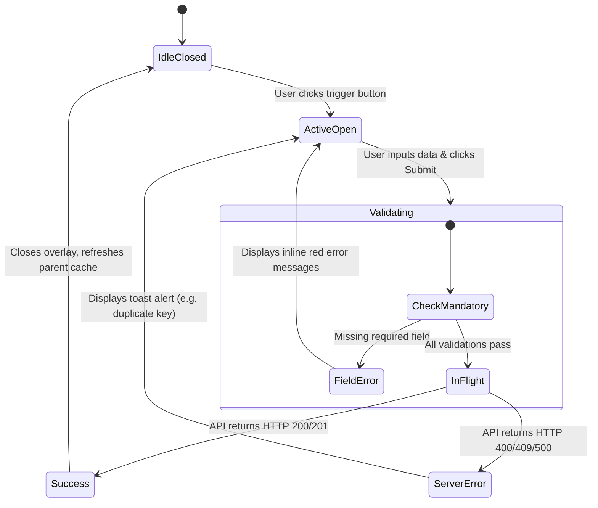

# Modal / Drawer Reference: [Modal Name] Documentation Template

> **Authoring Note:** Use this template whenever adding a new modal dialog, slide-over drawer, or popup overlay to `docs/user-manual/03-module-guides/modal-reference/`. All sections are mandatory.

---

## 1. Overlay Overview & Trigger Context

- **Component Name:** `[ComponentName.tsx]` (e.g., `CreateAssetModal.tsx`)
- **Overlay Type:** [Centered Modal ($512\text{px}-768\text{px}$) / Right Slide-Over Drawer ($480\text{px}$) / Alert Dialog / Popover]
- **Trigger Location:** [Page name and button label that opens this overlay, e.g. "Asset Master (`/assets`) $\to$ '+ New Asset' Button".]
- **Permitted User Roles:**
  - `Organization Admin` ([Permission string, e.g. `assets:write`])
  - `Plant Reliability Engineer` ([Permission string])
- **Keyboard Shortcuts & Focus Management:**
  - `Escape` (`ESC`): Closes overlay immediately (returns focus to trigger button).
  - `Tab` / `Shift + Tab`: Cycles sequentially through focusable inputs within the focus trap.
  - `Enter`: Submits the form if all mandatory fields are valid.

---

## 2. Form Fields & Input Validation Specifications

The table below catalogs every interactive field, selector, and control inside the overlay:

| Field Label | Parameter Key (API) | Input Control Type | Required? | Default Value | Validation Rules & Constraints | Error Message on Failure |
|---|---|---|:---:|---|---|---|
| **[Field Label 1]** | `code` | Text Input (Mono) | **Yes** | Auto-generated | 3–20 chars, uppercase alphanumeric + hyphens (`/^[A-Z0-9-]+$/`) | *"Asset code must be alphanumeric uppercase."* |
| **[Field Label 2]** | `name` | Text Input | **Yes** | `""` | 3–100 chars, trimmed | *"Asset name is required."* |
| **[Field Label 3]** | `category` | Select Dropdown | **Yes** | `'BOILER'` | Must match `AssetCategory` enum | *"Select a valid equipment category."* |
| **[Field Label 4]** | `designPressure` | Number Input | No | `null` | Positive float, max 100.0 bar | *"Pressure cannot exceed 100 bar."* |
| **[Field Label 5]** | `notes` | Textarea | No | `""` | Max 1,000 characters | *"Notes exceed maximum length."* |

---

## 3. Annotated Screenshot & Visual Analysis

![[Figure Caption]](file:///e:/My%20Owns/docs/user-manual/screenshots/annotated/[OVERLAY-SCREENSHOT-ID]-annotated.png)

*Figure [X]: [Modal Name] Overlay rendered at [Resolution] ([OVERLAY-SCREENSHOT-ID](file:///e:/My%20Owns/docs/user-manual/screenshots/annotated/[OVERLAY-SCREENSHOT-ID]-annotated.png)).*

### Annotated Callout Reference Table:

| Callout # | UI Element Name | Control Type | Description & Operational Purpose |
|:---:|---|---|---|
| **1** | Modal Header & Dismiss | Title Bar + `X` Button | Displays overlay title, subtitle, and close button (`<X />`). |
| **2** | Primary Input Field | Text Input | Accepts primary identifier; auto-focused on modal open. |
| **3** | Option Selector / Radio | Dropdown / Segmented | Configures operational mode or category classification. |
| **4** | Dynamic Attributes Sub-Form | Collapsible Section | JSONB key-value inputs tailored to the selected equipment category. |
| **5** | Cancel / Back Button | Secondary Button | Discards uncommitted changes and closes the overlay. |
| **6** | Submit / Confirm Button | Primary Action Button | Validates all fields and commits record via API POST/PUT request. |

---

## 4. Overlay Lifecycle & Submission Behavior

### State Details:
1. **Initial Mount**: All fields reset to defaults; focus moves to the first interactive field.
2. **In-Flight Submission**: Submit button displays an animated spinner (`<Loader2 className="animate-spin" />`) and all inputs are temporarily disabled to prevent double submissions.
3. **Success State**:
   - Displays a green toast notification: `"[Entity] created successfully."`
   - Closes the overlay automatically.
   - Refreshes parent query cache (React Query / SWR / store).
4. **Error Handling**:
   - HTTP 400 Bad Request: Highlights erroneous fields in red with descriptive helper text.
   - HTTP 409 Conflict: Displays banner: `"Duplicate record detected. Modify identifier."`

---

## 5. Responsive Behavior Across Device Viewports

| Viewport Tier | Resolution | Overlay Adaptation Logic |
|---|---|---|
| **Desktop ($1440 \times 900$)** | Centered floating dialog (`max-w-2xl rounded-2xl shadow-2xl`) with backdrop blur (`backdrop-blur-md`). |
| **Tablet Landscape ($1180 \times 820$)** | Centered floating dialog or slide-over drawer anchored to the right side of the screen. |
| **Tablet Portrait ($820 \times 1180$)** | Centered dialog with increased touch padding and minimum $44\text{px}$ button heights. |
| **Mobile ($390 \times 844$)** | Converts into a **full-screen bottom sheet** (`w-full rounded-t-3xl max-h-[95vh] overflow-y-auto`). |

---

## 6. Unsaved Changes Guard

If the user has entered data into any form field and attempts to close the overlay by clicking the backdrop or pressing `ESC`:
- **If pristine (no edits)**: Closes immediately without confirmation.
- **If dirty (unsaved edits)**: Displays a browser confirmation dialog or modal guard:
  `"You have unsaved changes. Are you sure you want to discard them?"`
  - Tapping **"Discard"** resets the form and closes the overlay.
  - Tapping **"Keep Editing"** returns focus to the form.
