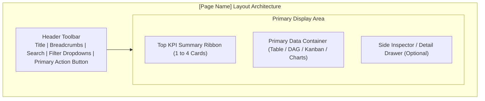

# [Module Name]: [Page Name] Documentation Template

> **Authoring Note:** Use this template whenever adding a new page or updating an existing page in `docs/user-manual/03-module-guides/`. All sections are mandatory. Do not remove sections; if a feature is not applicable, state *"Not applicable to this page."*

---

## 1. Page Overview

- **Page Title:** [Full Human-Readable Page Title]
- **Route Path:** `/[route-path]` (e.g., `/compressors`)
- **Primary Operational Goal:** [1-2 sentences explaining why facility staff visit this screen and what operational outcome is achieved.]
- **Permitted User Roles:**
  - `Organization Admin` ([Permission string, e.g. `assets:manage`])
  - `Plant Reliability Engineer` ([Permission string, e.g. `assets:read`])
  - `Maintenance Technician` ([Permission string])
  - `Boiler Plant Operator` ([Permission string])
- **Access Path:** [How the user accesses this page: Sidebar link, Header quick-action, direct link from another page.]
- **Related Pages:**
  - `[Related Page Name](file:///e:/My%20Owns/docs/user-manual/03-module-guides/xx-page.md)`

---

## 2. Page Architecture & Layout Structure

### Layout Sections:
1. **Header & Context Toolbar**: [Describe breadcrumbs, tenant scope, and primary actions such as "Create New" or "Export PDF".]
2. **Summary Metric Ribbon**: [Describe top cards displaying counts, percentages, or status totals.]
3. **Primary Data View**: [Describe the central view: data table, Kanban board, DAG diagram, or telemetry console.]
4. **Detail Drawer / Sidebar Inspector**: [Describe any slide-over drawer or context pane linked to row clicks.]

---

## 3. Annotated Screenshot & Visual Analysis

![[Figure Caption]](file:///e:/My%20Owns/docs/user-manual/screenshots/annotated/[SCREENSHOT-ID]-annotated.png)

*Figure [X]: [Page Name] Interface rendered at [1440x900 / 820x1180] ([SCREENSHOT-ID](file:///e:/My%20Owns/docs/user-manual/screenshots/annotated/[SCREENSHOT-ID]-annotated.png)).*

### Annotated Callout Reference Table:

| Callout # | UI Element Name | Element Type | Purpose & Interaction Behavior | Permissions Required |
|:---:|---|---|---|---|
| **1** | [Element 1 Name] | Button / Toolbar | [What happens when clicked or activated.] | [Permission string] |
| **2** | [Element 2 Name] | Search Input | [Search behavior, debounce, supported query terms.] | `read` |
| **3** | [Element 3 Name] | Dropdown Filter | [Available filter options, default state.] | `read` |
| **4** | [Element 4 Name] | Primary Table / Grid | [Row interaction, sortable columns, selection behavior.] | `read` |
| **5** | [Element 5 Name] | Action Menu | [Row-level actions: Edit, View, Delete, Escalate.] | `write` / `admin` |
| **6** | [Element 6 Name] | Status Badge | [Color coding and state indicators.] | Public |

---

## 4. Detailed Component & Field Specifications

Document every interactive control, button, input, and selector on the page:

### 4.1 Action Controls & Buttons

| Button / Control Label | Location | Visual Tone | Icon | Click Behavior & Target Modal | Permissions Required |
|---|---|---|---|---|---|
| `[Button Label]` | Top Right Toolbar | Gold / Indigo / Red | `Plus` / `Download` | Opens `[TargetModalName]` | `[perm:write]` |
| `[Action 2]` | Table Row Action | Slate Ghost | `Eye` / `Edit` | Slides out `[DetailDrawerName]` | `[perm:read]` |

### 4.2 Data Table Columns & Sorting

| Column Header | Data Field / Key | Data Type | Sortable? | Alignment | Display Format / Badge Tones |
|---|---|---|:---:|:---:|---|
| **Code / Tag** | `code` | String (Mono) | Yes | Left | Bold monospace text (`BLR-001`) |
| **Name / Description** | `name` | String | Yes | Left | Standard text, truncated with tooltip |
| **Status** | `status` | Enum | Yes | Center | Status badge (Green/Amber/Red) |
| **Created At** | `createdAt` | ISO DateTime | Yes | Right | Localized date (`YYYY-MM-DD HH:mm`) |

---

## 5. Responsive Behavior Across Device Viewports

| Viewport Tier | Resolution | Layout Behavior & Component Adaptations |
|---|---|---|
| **Desktop Workstation** | $1440 \times 900$ | Persistent sidebar (`w-64`), full multi-column grid, side-by-side filter toolbar, hover row highlight. |
| **Tablet Landscape** | $1180 \times 820$ | Persistent sidebar, 2-column metric cards, table enclosed in `overflow-x-auto` horizontal scroll buffer. |
| **Tablet Portrait** | $820 \times 1180$ | Collapsible hamburger drawer (`lg:hidden`), single-column stacked cards, minimum $44\text{px}$ touch targets. |
| **Mobile Smart Device** | $390 \times 844$ | Single-column vertical scroll flow, condensed header, horizontal table swipe, full-screen bottom sheets. |

---

## 6. Common Errors, Validation & Recovery Procedures

### Error Condition 1: [Descriptive Error Name]
- **Symptoms:** [What the user experiences: toast notification, red border, disabled submit button.]
- **Root Cause:** [Codebase explanation: missing required field, HTTP 403 Forbidden, session expiration.]
- **Step-by-Step Resolution:**
  1. [Action 1]
  2. [Action 2]
  3. [Action 3]
- **Escalation Path:** [Contact Organization Administrator or Plant Reliability Engineer.]
