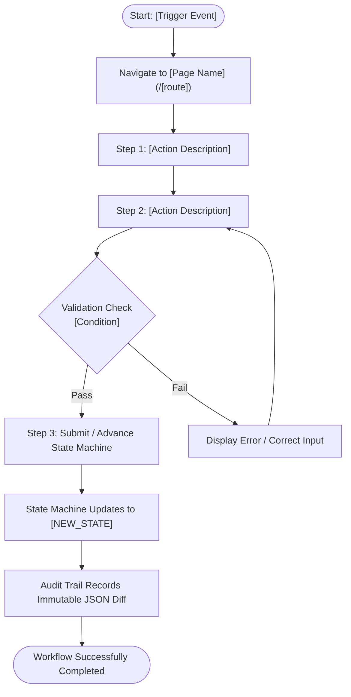

# Workflow [Number]: [Workflow Name] Documentation Template

> **Authoring Note:** Use this template whenever creating or modifying an operational workflow in `docs/user-manual/05-workflows/`. All workflows must reflect real, code-verified application logic.

---

## 1. Workflow Overview & Operational Intent

- **Workflow Title:** [Full Descriptive Workflow Title]
- **Operational Objective:** [Why does the user perform this task? What plant or business outcome is achieved?]
- **Required User Roles:**
  - `[Primary Role, e.g. Maintenance Technician]` ([Permission string, e.g. `work_orders:write`])
  - `[Secondary Role, e.g. Plant Reliability Engineer]` ([Permission string])
- **Operational Triggers:**
  - [Routine Schedule / Periodic PM Due / Sensory Abnormality / Automated Alarm / Shift Turnover]
- **Prerequisites & System Preconditions:**
  1. User is authenticated under a valid organization tenant scope.
  2. [Precondition 2, e.g. Asset record exists in Asset Master.]
  3. [Precondition 3, e.g. Prior work order is in ASSIGNED status.]
- **Expected Outcome:**
  - [Final system state: record committed, state machine advanced, audit log written, cost ledger updated.]

---

## 2. Workflow Decision & Execution Architecture

---

## 3. Step-by-Step Operational Procedure

Follow this step-by-step sequence to execute the workflow:

### Step 1: Navigate to the Target Module
- **Action:** Click **[Module Name]** in the left navigation sidebar (or tap the hamburger menu on mobile/tablet).
- **URL Path:** `/[route-path]`
- **Expected UI State:** The `[Page Name]` interface loads, displaying the primary data grid and action toolbar.

### Step 2: [Action Title, e.g. Open Create Work Order Modal]
- **Action:** Click the gold **"+ [Action Button Label]"** button in the top-right toolbar.
- **Expected UI State:** The `[Modal Name]` overlay appears over a blurred background backdrop with focus placed on the first input field.
- **Verification Screenshot:**
  ![[Screenshot Caption]](file:///e:/My%20Owns/docs/user-manual/screenshots/annotated/[SCREENSHOT-ID]-annotated.png)
  *Figure [X]: [Screenshot Caption] ([SCREENSHOT-ID](file:///e:/My%20Owns/docs/user-manual/screenshots/annotated/[SCREENSHOT-ID]-annotated.png)).*

### Step 3: Enter Required Information & Configure Options
- Fill in the required parameters as specified below:
  - **[Field 1 Name]:** Enter `"[Sample Value]"`.
  - **[Field 2 Name]:** Select `"[Option Value]"` from the dropdown.
  - **[Field 3 Name]:** [Specify numerical bounds or formatting rules].

### Step 4: Validate & Submit
- **Action:** Click the primary green/gold **"[Submit Button Label]"** button (or press `Enter`).
- **Expected UI State:** The button displays a loading spinner for ~300ms, a green confirmation toast appears (`"[Entity] saved successfully"`), the modal closes, and the new record appears at the top of the data list.

### Step 5: Advance Lifecycle State (If Applicable)
- [Detail any state machine transitions, e.g. dragging a Kanban card from `ASSIGNED` to `IN_PROGRESS` or entering closeout notes.]

---

## 4. Exception Handling & Recovery Scenarios

| Failure Scenario | Root Cause | Observable Symptom | Corrective Action |
|---|---|---|---|
| **Form Validation Error** | Missing mandatory field or out-of-range value. | Red border on input; submit button disabled or toast alert. | Correct the highlighted input field according to the benchmark range and re-submit. |
| **HTTP 409 Conflict** | Concurrent edit or duplicate unique code. | Toast: *"Record already exists or was modified by another user."* | Refresh page data or select "Amend as Traceable Revision" in the sync drawer. |
| **Offline Network Loss** | Tablet loses Wi-Fi in boiler room basement. | Header pill pulses yellow: *"Queued Offline (1 Pending)"*. | Continue logging; records buffer in IndexedDB and synchronize automatically upon reconnect. |
| **HTTP 403 Forbidden** | Active role lacks required permission. | Red banner: *"Access Denied: Insufficient Role Permissions."* | Switch to an authorized role via the top bar role switcher or contact the Organization Admin. |

---

## 5. Post-Execution Audit Verification

To independently verify that the workflow executed successfully:

1. **Verify Core Entity State:**
   - Navigate to `/[route-path]` and verify that the target entity displays the updated status pill (e.g., `COMPLETED` or `ACTIVE`).
2. **Verify Immutable Audit Trail:**
   - Navigate to **Audit & Evidence (`/audit-evidence`)** and verify that a new audit record was created with the action code `[ACTION_CODE]`, recording your user UUID and a before/after JSON diff.
3. **Verify Financial Ledger (If Applicable):**
   - Navigate to **Cost Analytics (`/cost-analysis`)** and confirm that parts and labor costs logged during this workflow are reflected in the category spend chart.
